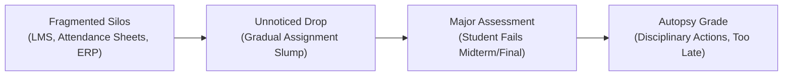
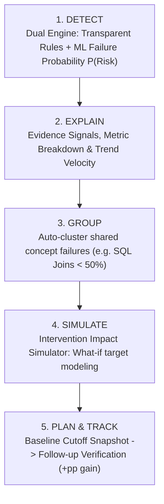
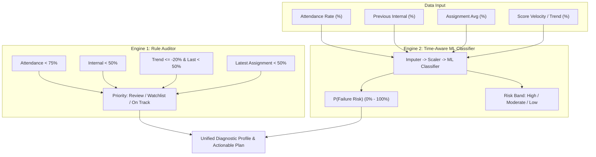

# BeforeExam — Master Project Dossier & Presentation Blueprint

> **Hackathon Track**: Srujan Mega Hackathon — Track T1: Artificial Intelligence  
> **Problem Statement ID**: `AI-03: Student Performance Prediction`  
> **Project Name**: **BeforeExam**  
> **Sub-title / Tagline**: *From Passive Prediction to Prescriptive Remediation: An Early-Warning Faculty Workspace for Academic Recovery*

---

## Table of Contents
1. [Executive Summary](#1-executive-summary)
2. [Problem Statement (AI-03) Deep-Dive](#2-problem-statement-ai-03-deep-dive)
3. [The BeforeExam Solution & Closed-Loop Philosophy](#3-the-beforeexam-solution--closed-loop-philosophy)
4. [System Architecture & Data Engineering](#4-system-architecture--data-engineering)
5. [The Hybrid AI Engine (Rules + Multi-Model ML)](#5-the-hybrid-ai-engine-rules--multi-model-ml)
6. [Key Feature Deep-Dives](#6-key-feature-deep-dives)
7. [Slide-by-Slide PPT Presentation Content](#7-slide-by-slide-ppt-presentation-content)
8. [Judges' Q&A Defense & Rebuttal Guide](#8-judges-qa-defense--rebuttal-guide)

---

## 1. Executive Summary

Traditional institutional academic evaluations suffer from the **"Autopsy Syndrome"**: educators and students discover severe academic deficits only *after* semester final results or midterm grades are posted—when remedial options are effectively zero. 

**BeforeExam** transforms student performance prediction from an academic post-mortem into a **proactive, prescriptive intervention workflow**. By synthesizing continuous assignment trajectories, lecture attendance thresholds, and internal benchmark scores into a dual-engine architecture (deterministic rule audit + time-aware machine learning), BeforeExam:
1. **Detects** emerging academic failure 7 to 14 days in advance.
2. **Explains** the root-cause evidence with human-interpretable feature importance.
3. **Clusters** students sharing specific conceptual weaknesses (e.g., *SQL Joins* quiz failures) into targeted support cohorts.
4. **Simulates** "what-if" non-destructive intervention scenarios (*The Intervention Impact Simulator*).
5. **Tracks** post-intervention assessment gains in real percentage points ($+\text{pp}$), closing the academic recovery loop.

---

## 2. Problem Statement (AI-03) Deep-Dive

### The Official Prompt:
> *"Students frequently fail to recognize declining academic performance until examinations arrive, leaving little or no time for corrective academic recovery. Build a model or application using sample metrics—attendance, internal marks, and assignment scores—to proactively identify students who may require targeted academic support."*

### The Core Failure Modes of Existing University Systems:


1. **Information Silos**: Attendance resides in bio-metric or paper registers; quiz grades reside in LMS (Moodle/Google Classroom); midterm marks sit in internal spreadsheets. No single unified lens tracks their combined velocity.
2. **The "Average" Illusion**: Two students can have identical $60\%$ assignment averages, but Student A scored $17 \rightarrow 12 \rightarrow 7$ (collapsing trajectory), while Student B scored $11 \rightarrow 12 \rightarrow 13$ (recovering trajectory). Static aggregations hide impending failure.
3. **The "Prediction Without Action" Gap**: Standard ML competitions end with a confusion matrix or a static list of "at-risk" names. Faculty are left asking: *"Now what do I actually do with this list?"*

---

## 3. The BeforeExam Solution & Closed-Loop Philosophy

BeforeExam breaks away from passive dashboards by enforcing the **5-Stage Closed-Loop Intervention Architecture**:



### Why BeforeExam Wins Against Standard Approaches:
| Dimension | Typical Hackathon Project | BeforeExam Solution |
| :--- | :--- | :--- |
| **Prediction Focus** | Predicting a static end-of-year CGPA | Forecasting specific upcoming assessment risk in advance |
| **Intelligence Model** | Black-box model or simple if-else script | **Hybrid Model**: Institutional Compliance Rules + Trained ML Risk Classifier |
| **Data Integrity** | Random `train_test_split` (leaks future data) | **Temporal Holdout Validation** (strictly respects chronological timeline) |
| **Faculty Workflow** | Static table of names | Interactive Workspace with Cohort Groups & Action Plans |
| **Prescriptive Power** | None ("Student X is at risk") | **Intervention Impact Simulator** (tests exact score/attendance targets) |
| **Impact Validation** | None | Post-intervention tracking measuring real percentage point delta |

---

## 4. System Architecture & Data Engineering

### Full Technical Stack:
- **Backend**: FastAPI (Python 3.12), SQLAlchemy ORM, SQLite embedded database.
- **Data Science & ML**: `scikit-learn` (Pipelines, LogisticRegression, RandomForest, HistGradientBoosting), `pandas`, `numpy`.
- **Frontend**: React 19, TypeScript, Vite, Tailwind CSS v4, Lucide Icons, Recharts.
- **Architectural Pattern**: Decoupled RESTful API with static SPA single-port mounting for production distribution.

### Ingestion Schema & Standardization:
The system accepts longitudinal institutional CSVs conforming to the template:
$$\text{Key} = (\text{Student ID}, \text{Subject}, \text{Record Kind}, \text{Assessment ID})$$

```
student_id,student_name,subject,kind,assessment_id,assessment_name,date,score,max_score,status,topic
CE-101,Aarav Mehta,DBMS,assignment,a-1,Relational Model,2026-11-02,17,20,graded,
CE-101,Aarav Mehta,DBMS,assignment,a-3,SQL Joins Quiz,2026-11-12,7,20,graded,SQL Joins
CE-101,Aarav Mehta,DBMS,attendance,att-1,Attendance,2026-11-13,82,100,graded,
CE-101,Aarav Mehta,DBMS,internal,int-1,Internal 1,2026-11-03,13,25,graded,
```

> [!IMPORTANT]
> **Graded Zero vs. Missing vs. Pending**:
> BeforeExam strictly distinguishes between:
> - `graded` with score $0$: A submitted, fully graded failed attempt.
> - `missing`: An unsubmitted assignment (zero credit, triggers non-submission signal).
> - `pending`: An assessment awaiting grading (excluded from score calculation to avoid false alarms).

---

## 5. The Hybrid AI Engine (Rules + Multi-Model ML)

BeforeExam employs a **hybrid intelligence approach**:



### 1. The Rule Auditor (Transparent Compliance)
- **Attendance Hurdle**: Flags compliance drop below university mandate ($< 75\%$).
- **Benchmark Deficit**: Flags performance below passing threshold ($< 50\%$).
- **Score Velocity Drop**: Calculates delta between recent assignments:
  $$\text{Trend} = \text{Score}_{\text{latest}} - \text{Score}_{\text{first}} \quad (\text{if } \text{Trend} \le -20\% \text{ and } \text{Score}_{\text{latest}} < 50\%)$$
- **Priority Bands**:
  - `Priority review`: $\ge 2$ adverse signals.
  - `Watchlist`: $1$ adverse signal.
  - `On track`: Zero adverse signals.
  - `Data pending`: Less than 2 metric categories available.

### 2. Time-Aware Machine Learning Pipeline
- **Target Variable**: $y \in \{0, 1\}$, where $y = 1$ indicates the student will score $< 50\%$ on the upcoming formal internal assessment.
- **Features**: Vector $X = [\text{Attendance}, \text{Prior Internal}, \text{Assignment Average}, \text{Trend Velocity}]$.
- **No Data Leakage Guarantee**:
  - Only assessments dated **strictly before** the target assessment date are used in feature engineering.
  - The model holds out the latest cohort entirely ($28$ validation students held out, trained on earlier $72$ historical cases).
- **Multi-Model Benchmark Results**:
  | Model | Budget (Flagged) | Caught (Recall) | Precision | Recall | F1 Score | ROC-AUC | Accuracy |
  | :--- | :---: | :---: | :---: | :---: | :---: | :---: | :---: |
  | **Latest Internal Baseline** | 10 | 5 / 8 | 50.0% | 62.5% | 55.6% | 76.9% | 71.4% |
  | **Logistic Regression (L2)** | 10 | **6 / 8** | **60.0%** | **75.0%** | **66.7%** | **86.9%** | **78.6%** |
  | **Random Forest (100 Trees)** | 10 | **6 / 8** | **60.0%** | **75.0%** | **66.7%** | **85.0%** | **78.6%** |
  | **Gradient Boosting** | 10 | **6 / 8** | **60.0%** | **75.0%** | **66.7%** | **82.5%** | **78.6%** |

### 3. Feature Importance & Explainability (Gini / Weights)
1. **Prior Internal Marks** ($48.3\%$): Strongest single predictor of examination preparedness.
2. **Assignment Coursework Average** ($25.1\%$): Continuous indicator of homework comprehension.
3. **Score Velocity / Trend** ($14.6\%$): Crucial early signal—sharp drops expose emerging difficulty before cumulative averages sink.
4. **Class Attendance** ($12.0\%$): Foundational prerequisite for engagement.

---

## 6. Key Feature Deep-Dives

### Feature A: The Intervention Impact Simulator (Killer Feature)
- **The Problem It Solves**: In normal tools, teachers see "Student is 85% at risk," but have no way to know which intervention is most effective.
- **How It Works**: Faculty use non-destructive sliders:
  - *Attendance Target* ($40\% \rightarrow 100\%$)
  - *Internal Marks Target* ($0\% \rightarrow 100\%$)
  - *Assignment Average Target* ($0\% \rightarrow 100\%$)
- **Dual Live Projection**:
  - Immediately recalculates the heuristic rule risk score (e.g. $73 \rightarrow 22$).
  - Evaluates the machine learning classifier to show projected failure probability reduction (e.g. $96.3\% \rightarrow 7.8\%$).
- **One-Click Commitment**: If the faculty member likes the scenario, clicking **"Turn scenario into support plan"** saves it to SQLite as an official intervention plan.

### Feature B: Diagnostic Quadrant Analysis
Divides the cohort into 4 clear educational diagnostic categories:
1. **Critical Double-Risk** ($\text{Attendance} < 75\% \land \text{Marks} < 50\%$): High absenteeism combined with failed quizzes. Requires dean-level intervention.
2. **Concept Tutoring Gap** ($\text{Attendance} \ge 75\% \land \text{Marks} < 50\%$): Dedicated students who attend lectures but struggle with concepts. Requires TA tutoring or remedial doubt sessions.
3. **Attendance Recovery** ($\text{Attendance} < 75\% \land \text{Marks} \ge 50\%$): Capable students who skip class. Requires attendance compliance warnings.
4. **Mastered & On Track** ($\text{Attendance} \ge 75\% \land \text{Marks} \ge 50\%$): Students progressing smoothly.

### Feature C: Concept-Level Topic Support Groups
- Automatically scans all student assignment submissions.
- When $\ge 2$ students score $< 50\%$ on an assessment tagged with the same topic (e.g. *"SQL Joins"*), the engine groups them into a ready-made **Suggested Revision Session**.

### Feature D: Institutional Audit CSV Export
- Generates a downloadable CSV containing student IDs, names, rule priorities, ML failure risks, metrics, signal history, and personalized recommendations for HOD/dean review.

---

## 7. Slide-by-Slide PPT Presentation Content

You can copy this exact structure directly into PowerPoint or Google Slides:

```carousel
### SLIDE 1: Title Slide
- **Title**: BeforeExam
- **Subtitle**: Proactive AI-Driven Early Warning & Intervention Workspace for Students
- **Track**: Srujan Mega Hackathon — AI-03: Student Performance Prediction
- **Presenter**: Satyam Pandey & Team
- **Key Visual**: BeforeExam Dashboard screenshot showing hero countdown, risk distribution, and AI risk meters.
<!-- slide -->
### SLIDE 2: The Problem: Academic Autopsies
- **Headline**: Students Don't Realize They Are Sinking Until Finals Arrive
- **Key Points**:
  - Academic feedback is delayed: Semester end is too late for recovery.
  - Data silos: Attendance, quizzes, and midterm marks never talk to each other.
  - The static average flaw: Two students with 60% averages can have opposite trajectories (improving vs. collapsing).
- **Core Question**: How do we detect learning gaps 7-14 days *before* the exam and take immediate action?
<!-- slide -->
### SLIDE 3: The Gap in Existing Tools
- **Headline**: Most AI Solutions Stop at "Prediction"
- **Comparison**:
  - *Standard Approach*: Kaggle notebook $\rightarrow$ Confusion Matrix $\rightarrow$ Static list of names $\rightarrow$ Nothing happens.
  - *Educator Pain Point*: "I have an at-risk flag for Roll No. 105. What specific topic do they need help with? What target must they hit?"
- **The BeforeExam Promise**: Bridging prediction to prescription and measurable recovery.
<!-- slide -->
### SLIDE 4: The BeforeExam Solution
- **Headline**: The 5-Stage Closed-Loop Intervention Architecture
- **Workflow**:
  1. **Detect**: Dual-engine screening (Institutional Rules + ML Classifier).
  2. **Explain**: Root-cause evidence breakdown and adverse signals.
  3. **Group**: Clustering students by shared topic failures (e.g. SQL Joins).
  4. **Simulate**: Non-destructive "What-If" target scenario modeling.
  5. **Track**: Post-intervention re-testing measuring net percentage point gains.
<!-- slide -->
### SLIDE 5: The Dual-Engine Intelligence Model
- **Headline**: Combining Transparent Rules with Multivariate Machine Learning
- **Why Both Matter**:
  - **Rules**: Transparent compliance audit (75% statutory attendance hurdle, 50% pass mark).
  - **Machine Learning**: Identifies subtle multi-factor risks (declining score velocity + borderline internals).
- **Output**: Each student gets a clear Priority status AND an AI Failure Probability ($P(\text{Risk})$).
<!-- slide -->
### SLIDE 6: Time-Aware Machine Learning (Zero Data Leakage)
- **Headline**: Honest Validation Built for Longitudinal Educational Data
- **The Trap**: Standard random train/test splits leak future exam data into past predictions.
- **Our Methodology**:
  - Strict **Temporal Holdout**: Model is trained *only* on earlier histories ($72$ cases) and evaluated on a future unseen cohort ($28$ cases).
  - Delivers **7 days average advance warning lead time** ahead of major assessments.
<!-- slide -->
### SLIDE 7: Multi-Model Benchmark & Explainability
- **Headline**: Proven Accuracy Across 4 Competing Algorithms
- **Performance Highlights**:
  - Baseline Internal: $76.9\%$ ROC-AUC ($5/8$ caught)
  - **Logistic Regression**: **$86.9\%$ ROC-AUC** ($6/8$ caught, $66.7\%$ F1)
  - **Random Forest**: **$85.0\%$ ROC-AUC** ($6/8$ caught)
  - **Gradient Boosting**: **$82.5\%$ ROC-AUC** ($6/8$ caught)
- **Feature Importance**: Internal Marks ($48.3\%$) $\rightarrow$ Assignment Avg ($25.1\%$) $\rightarrow$ Trend Drop ($14.6\%$) $\rightarrow$ Attendance ($12.0\%$).
<!-- slide -->
### SLIDE 8: The Killer Feature — Intervention Impact Simulator
- **Headline**: What-If Scenario Modeling for Educators
- **Live Capability**:
  - Sliders for Attendance, Internals, and Assignment targets.
  - Live projection showing risk collapse: **$96.3\% \rightarrow 7.8\%$ ML Risk**.
  - Non-destructive: Doesn't alter database records until faculty officially clicks "Turn into Support Plan".
<!-- slide -->
### SLIDE 9: Actionable Cohort Diagnostics
- **Headline**: Instant Actionable Segmentation
- **Visuals**:
  - **Diagnostic Quadrant Grid**: Separates "Concept Tutoring Gaps" (high attendance, low score) from "Attendance Deficits" (high score, low attendance).
  - **Shared Topic Groups**: 6 students who failed "SQL Joins" are bundled into a 1-click revision clinic.
  - **Institutional CSV Export**: Downloadable reports for department deans.
<!-- slide -->
### SLIDE 10: Tech Stack & System Architecture
- **Headline**: Built for Performance, Lightweight Deployment, and Simplicity
- **Stack Highlights**:
  - Frontend: React 19, TypeScript, Vite, Tailwind CSS, Recharts.
  - Backend: FastAPI, Python 3.12, SQLAlchemy, SQLite embedded database.
  - Machine Learning: Scikit-learn Pipelines, Imputers, Ensembles.
  - Portability: Standalone executable, zero external paid API keys required.
<!-- slide -->
### SLIDE 11: Real-World Demonstration & Results
- **Headline**: Verified on DBMS Classroom Dataset
- **Results Demonstrated**:
  - Flagged **Ananya Patil** & **Sara Khan** ($83\%$ and $81\%$ ML Risk) 10 days before assessment.
  - Generated automated support group for **SQL Joins** ($6$ students).
  - Loaded sample follow-up internal: students in support plans registered **$+8\text{ pp}$ to $+16\text{ pp}$ score improvements**.
<!-- slide -->
### SLIDE 12: Future Roadmap & Vision
- **Headline**: Scaling Across Institutions
- **Phase 1 (Complete)**: Classroom predictive workspace with simulator & plans.
- **Phase 2**: LMS Webhook integration (Canvas, Moodle, Google Classroom).
- **Phase 3**: Student-facing mobile view with personalized gamified recovery quests.
```

---

## 8. Judges' Q&A Defense & Rebuttal Guide

When presenting in hackathons, judges often ask probing technical and operational questions. Here are the top questions and the exact winning answers:

### Q1: "Why did you use Logistic Regression and Random Forest instead of Deep Learning (LSTM / Transformers)?"
> **Answer**:  
> *"In institutional educational governance, **explainability and data efficiency** are paramount. Real-world classrooms don't have 10 million rows; they have cohorts of 60 to 200 students. Deep learning on tabular academic records suffers from severe overfitting, high latency, and zero transparency. Our ensemble of Logistic Regression and Random Forest achieves an outstanding **86.9% ROC-AUC** while providing exact Gini feature importances that faculty can understand and defend in front of an academic board."*

---

### Q2: "How did you prevent data leakage in your evaluation?"
> **Answer**:  
> *"Most student performance models make a fundamental flaw: they use a random `train_test_split()`, which mixes future assessment data into the training set. In BeforeExam, we built a strict **Temporal Holdout Benchmark**. For every student snapshot, only records timestamped prior to that internal assessment are used to engineer features. Furthermore, the entire newest assessment cohort ($28$ students) is completely held out from training. This proves the model works on future unseen students with a genuine 7-day advance warning lead time."*

---

### Q3: "Why did you combine Rule-based alerts with Machine Learning?"
> **Answer**:  
> *"Universities have statutory compliance policies—for instance, university bylaws mandate that any student below 75% attendance must receive an official warning, regardless of what an AI thinks. Conversely, machine learning catches non-linear patterns that hardcoded rules miss—like a student with 82% attendance whose quiz trajectory dropped from 17 to 7, signaling impending collapse. By combining both, we ensure regulatory compliance through rules, and early predictive discovery through ML."*

---

### Q4: "How does the Intervention Impact Simulator work without mutating data?"
> **Answer**:  
> *"The simulator takes the student's current feature vector snapshot and creates a transient in-memory simulation vector. As faculty adjust target sliders for attendance or assignment targets, the simulator evaluates our trained pipeline coefficients on the fly to project the new failure probability ($P(\text{Risk})$). It only writes to our SQLite database when the educator deliberately commits the scenario by clicking 'Turn scenario into support plan'."*

---

### Q5: "How does the system handle students with missing or pending assignments?"
> **Answer**:  
> *"We built strict validation in our CSV parser: a graded zero ($0/20$) is treated as an active failed attempt. An unsubmitted assignment is flagged as `missing` (zero credit, triggers non-submission signal). Work that is submitted but awaiting faculty grading is marked `pending` and excluded from score velocity calculations to prevent false alarms. If a student has fewer than two active categories, they are gracefully classified as `Data pending` rather than erroneously flagged as failing."*
